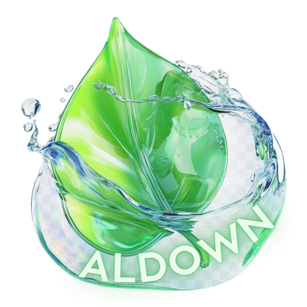
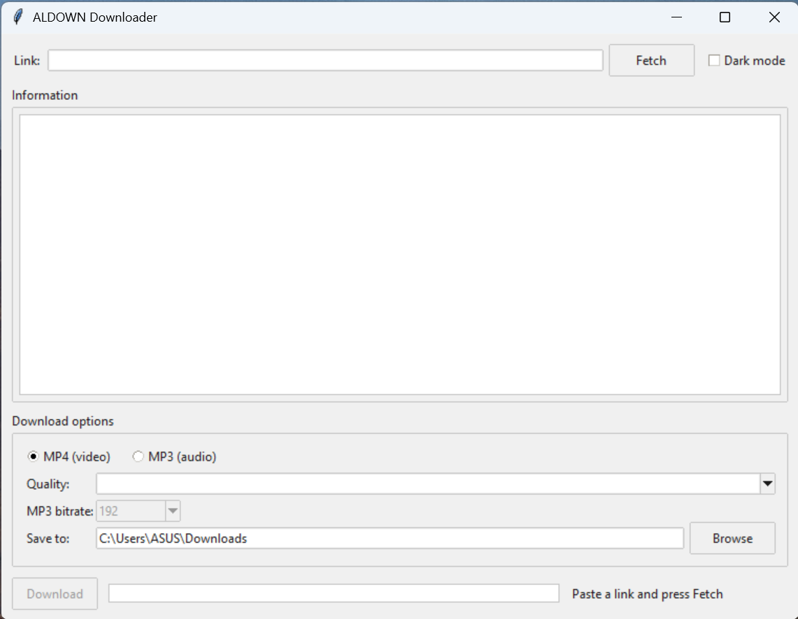
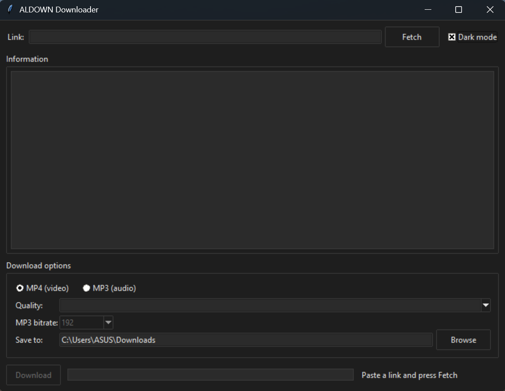
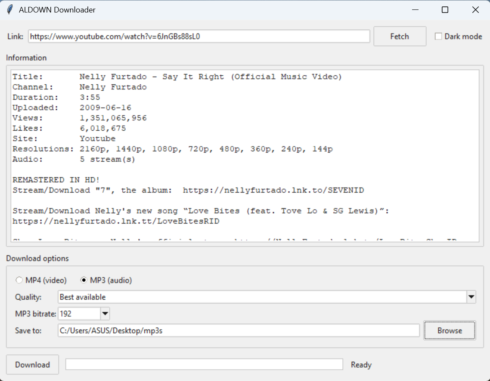

<p align="center">
  
</p>

<h1 align="center">ALDOWN Downloader</h1>

<p align="center">
  A simple desktop GUI for downloading video and audio, powered by <a href="https://github.com/yt-dlp/yt-dlp">yt-dlp</a>.

<p align="center">
  
  
  
</p>


## Features

- Paste a link and fetch details: title, channel, duration, upload date, views, likes, available resolutions
- MP4 (video): pick an exact resolution/format or the best available; video-only streams are automatically merged with the best audio
- MP3 (audio): pick an audio stream and bitrate (64–320 kbps)
- Codec, file size and format ID shown for every stream
- Live progress bar with speed and ETA
- Light and dark mode (including a dark Windows title bar), remembered between launches
- Works with [every site yt-dlp supports](https://github.com/yt-dlp/yt-dlp/blob/master/supportedsites.md), not just YouTube

## Screenshots

| Light mode | Dark mode |
|---|---|
|  |  |



## Download

Grab `Aldown_Downloader.exe` from the [latest release](https://github.com/alimetastic/aldown/releases/latest) — no Python needed.

> **ffmpeg is required** for MP3 conversion and for merging video + audio in high-resolution MP4 downloads.
> Install it with `winget install ffmpeg`, or download it from [ffmpeg.org](https://ffmpeg.org/download.html) and add it to your PATH.

Windows SmartScreen may warn about the unsigned .exe — click **More info → Run anyway**.

## Run from source

```bash
git clone https://github.com/alimetastic/aldown.git
cd aldown
pip install -r requirements.txt
python downloader.py
```

## Build the .exe yourself

```bash
pip install pyinstaller
pyinstaller --onefile --windowed --name Aldown_Downloader --icon assets/logo.ico downloader.py
```

The executable will be in `dist/`.

## Usage

1. Paste a link and press **Fetch** (or Enter).
2. Choose **MP4** or **MP3**.
3. Pick a quality (and a bitrate for MP3).
4. Choose a save folder and press **Download**.

Files are saved as `Title [1080p].mp4` or `Title.mp3`.

## Troubleshooting

| Problem | Fix |
|---|---|
| `ffmpeg not found` / ffprobe errors | Install ffmpeg and make sure it's on PATH |
| Fetch fails on a site that used to work | Update yt-dlp: `pip install -U yt-dlp` (or grab a newer release) |
| Video downloads without sound | ffmpeg is missing, so streams couldn't be merged |

## Settings

The dark mode preference is stored in `~/.ytdlp_gui.json`.

## License

[MIT](LICENSE)
